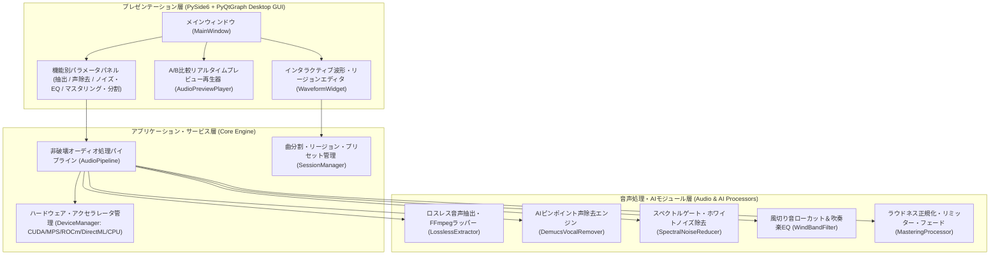

# SoundRemover システム思想・全体アーキテクチャ設計書

## 1. プロジェクトの目的と背景
中学生の吹奏楽部の発表（ホール演奏、屋外ステージ、パレード、コンクール練習など）を撮影した動画から音声を抽出し、**「楽器本来の音質・倍音・ダイナミクス（強弱）を一切損なわないこと」**を最優先としながら、不要な雑音（観客の話し声、アナウンス、咳払い、空調・ホワイトノイズ、屋外の風切り音）をピンポイントで除去し、聴きやすい音楽ファイルを作成するアプリケーションである。

一般的なWeb会議用のノイズキャンセリング（RNNoise等）は「人の声を残して楽器や周囲の音を消す」ように訓練されているため、音楽録音に適用すると楽器の伸びや倍音が消えてしまう。本システム（**SoundRemover**）ではその逆の発想および音楽特化の信号処理を採用する。

---

## 2. 基本設計思想（コア・フィロソフィー）

### (1) 完全ロスレス（無劣化）の追求
- **ストリーム直接抽出**: 動画コンテナ（MP4, MOV, MKV, MTS等）に含まれる元の音声ストリームを再エンコードなしでそのまま抜き出すモード（`ffmpeg -vn -acodec copy`）を備える。
- **高品位内部処理**: 音声加工を行う際は、元のサンプリングレート（44.1kHz / 48kHz / 96kHz）を維持したまま **32-bit 浮動小数点（float32）または 64-bit 浮動小数点** の非圧縮PCM配列上で演算を行い、最終書き出し時も 24-bit WAV やロスレス圧縮（FLAC）を選択可能とする。

### (2) 「必要な箇所にだけ適用する」ピンポイント非破壊設計
- 吹奏楽の録音において、演奏中ずっと観客が喋っているわけではなく、「曲の始まり・静かなソロの裏・曲間」などの**特定の数秒間だけ声や雑音が入る**ケースが多い。
- そのため、曲全体にAI処理やフィルタをかけるだけでなく、**波形を見ながら指定した時間範囲（リージョン）だけに声除去・ノイズ除去を適用し、それ以外の区間は100%無加工（ビットパーフェクト）のままクロスフェード結合する**仕組みを標準搭載する。

### (3) AI音源分離の「逆転活用」による声のピンポイント除去
- 人の声（300Hz〜3kHz中心）と管楽器（クラリネット、サックス、トランペット、ホルン等）の周波数帯域は完全に重なっているため、従来のイコライザー（EQ）で声だけを消すと楽器の音も消えてしまう。
- そこで最先端のAI音源分離モデル（**Hybrid Transformer Demucs: `htdemucs`**）を活用し、音源を「Vocals（人の声成分）」と「Instrumental（Drums + Bass + Other：楽器成分）」に分離する。
- 分離した「Vocals」成分のみを減衰（0%〜100%で調整可能）させて「Instrumental」成分を残すことで、**演奏音質を保ったまま人の声や呼びかけだけをピンポイントで除去**する。
- ※リスク対策：管楽器のソロ等でAIがごく一部を「声に近い」と誤認するリスクに備え、「声の除去率スライダー（0〜100%）」と「特定時間帯のみのピンポイント適用機能」および「Original / Processed のワンクリック聴き比べ機能」を提供する。

### (4) マルチプラットフォーム・マルチGPUアクセラレータ対応と配布容易性
同じ吹奏楽部の他の保護者にも配布できるよう、多様なPC環境に自動適応する設計とする。
- **NVIDIA GPU (Windows / Linux)**: PyTorch CUDA バックエンドによる高速推論
- **AMD / Intel 内蔵・外付けGPU (Windows)**: DirectML (`torch-directml`) または CPU マルチスレッドによる推論
- **Apple Silicon M1/M2/M3/M4 (macOS)**: PyTorch MPS (Metal Performance Shaders) バックエンドによる高速推論
- **AMD Strix Halo / Radeon (Linux)**: PyTorch ROCm バックエンドによる高速推論
- **CPU フォールバック**: GPUが無い環境でもマルチコアCPUを用いて確実に動作する設計

---

## 3. システム全体アーキテクチャ



---

## 4. ディレクトリ構成

```text
SoundRemover/
├── Doc/                                 # 設計書ディレクトリ
│   ├── 01_Architecture_and_Philosophy.md # システム思想・全体アーキテクチャ設計書
│   ├── 02_Audio_Processing_Design.md     # 音声処理・AIエンジン詳細設計書
│   └── 03_UI_and_Distribution_Design.md  # GUI画面設計・マルチ環境配布設計書
├── ToDo.md                              # 開発ToDo管理ファイル
├── pyproject.toml                       # Pythonプロジェクト・依存パッケージ定義 (uv / pip対応)
├── README.md                            # 使い方・環境別セットアップ・配布ガイド
├── run_windows.bat                      # Windows用ワンクリック起動スクリプト
├── run_unix.sh                          # Mac / Linux用ワンクリック起動スクリプト
├── src/
│   └── sound_remover/
│       ├── __init__.py
│       ├── main.py                      # アプリケーションエントリーポイント
│       ├── core/
│       │   ├── __init__.py
│       │   ├── device_manager.py        # GPU/CPU (CUDA/DirectML/MPS/ROCm/CPU) 検出・切替
│       │   ├── ffmpeg_manager.py        # FFmpegバイナリ検出・自動解決 (static-ffmpeg/system)
│       │   ├── audio_data.py            # 音声バッファ・リージョン・曲分割マーカーのデータ構造
│       │   └── pipeline.py              # 非破壊処理パイプライン＆クロスフェード合成エンジン
│       ├── processors/
│       │   ├── __init__.py
│       │   ├── extractor.py             # 動画からの完全ロスレス抽出・PCM読み込み・書き出し
│       │   ├── vocal_remover.py         # Demucsによるピンポイント声（話し声・雑音）除去
│       │   ├── noise_reducer.py         # ホワイトノイズ除去（ノイズプロファイル学習＆全体適用）
│       │   ├── eq_filter.py             # 屋外風切り音ハイパスフィルタ＆吹奏楽向けEQ
│       │   └── mastering.py             # ラウドネスノーマライズ・音割れ防止リミッター・フェード
│       └── ui/
│           ├── __init__.py
│           ├── main_window.py           # メインGUIウィンドウ
│           ├── waveform_widget.py       # 波形表示・範囲選択・ノイズ学習範囲・曲分割UI
│           ├── player_widget.py         # Original / Processed ワンクリックA/B聴き比べプレイヤー
│           └── theme.py                 # 視認性の高いダーク/モダンスタジオUIテーマ定義
└── tests/                               # 自動テストスイート
    ├── __init__.py
    ├── test_processors.py               # 抽出・ノイズ除去・EQ・マスタリング・リージョン合成の検証
    └── test_device_manager.py           # マルチアクセラレータ検出ロジックの検証
```
